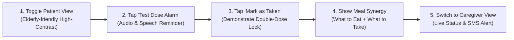

# CareSync (MediMate) — Prototype Publishing & Demo Guide

**Project:** CareSync / MediMate (ARISE Venture)  
**Institution:** Sreenidhi Institute of Science and Technology (SNIST)  
**Track:** Wadhwani Foundation Venture Viability Program  
**Team Members:** M. Pravalika, G. Uma Dharani, U. Vinay Charan (BTech 2nd Year)  

---

## 1. How to Publish Online in 10 Seconds (Free Public Web Link)

To get a live public link (like `https://caresync-snist.netlify.app`) that anyone can open on their mobile phone or laptop:

### Method A: Netlify Drop (Zero-Code, Instant)
1. Open your browser and go to: **[https://app.netlify.com/drop](https://app.netlify.com/drop)**
2. Open Windows Explorer to: `c:\Users\vinay\Carsss`
3. Drag and drop the **`health-prototype`** folder directly onto the upload box in Netlify.
4. Netlify will instantly provide a live, shareable public HTTPS web address.
5. You can copy that link and send it to your professors, evaluators, or teammates via WhatsApp/Email!

### Method B: Share via ZIP Package
* A complete, standalone package has been created:  
  📁 **[CareSync_MediMate_Prototype.zip](file:///c:/Users/vinay/Carsss/CareSync_MediMate_Prototype.zip)**  
  *(Send this file directly; anyone who unzips it can double-click `index.html` to run the app immediately with zero installation!)*

---

## 2. Live Demo Script (What to Show Evaluators)

Follow this 5-step walkthrough when presenting your project:

### Step 1: Show the Problem & Patient View
* **What to say:** *"According to the WHO, over 50% of chronic patients miss or confuse their daily doses. Our senior patient, Ramesh Kumar (age 68), manages both diabetes and hypertension. For seniors, we designed this high-contrast, large-font Patient View."*
* **What to point out:**
  * High-contrast cards for **Morning**, **Afternoon**, and **Night**.
  * Visual pill identifiers: **🟡 Yellow Round Tablet** for Blood Pressure, **⚪ White/Blue Capsule** for Vitamin D, and **🔴 Pink Oval** for Metformin.

### Step 2: Demonstrate the Audio & Voice Alarm
* **Action:** Click the top **"⏰ Test Dose Alarm"** button.
* **What happens:** The buzzer tone sounds, the screen pulses with pill guidance, and the voice assistant speaks aloud:  
  > *"Attention Ramesh! It is 8:00 AM. Time to take 1 tablet of Amlodipine from Box Compartment 1. Take immediately after breakfast with water."*
* **What to say:** *"Seniors don't just get a generic beep—they hear exactly how many tablets to take and which compartment to open."*

### Step 3: Demonstrate the Accidental Double-Dose Safety Lock
* **Action:** Tap **"Mark Morning Pill as Taken"**.
* **What happens:** The button locks into a green shield:  
  `🔒 Already Taken at 8:02 AM (Safety Locked)`.
* **Action:** Click it again.
* **What happens:** A safety warning toast pops up: *"Accidental Double-Dose Prevented! This dose was already taken and locked for your safety."*
* **What to say:** *"Elderly patients with memory lapses often forget they took a pill and take a second dose. CareSync physically locks the button to prevent accidental overdosing."*

### Step 4: Show the Nutrition & Medication Synergy
* **What to point out:**
  * **Morning:** Steamed Ragi Idli with Sambar paired with Amlodipine (Low salt prevents morning blood pressure spikes).
  * **Afternoon:** Brown Rice with Palak Dal (potassium counteracts sodium) + Vitamin D3 (requires fat from curd).
  * **Night:** Foxtail Millet Khichdi + Metformin (prevents stomach upset).

### Step 5: Switch to Caretaker View
* **Action:** Click the top toggle to **"🩺 Caregiver Dashboard"**.
* **What to say:** *"For the family, Ramesh's daughter Sarah Johnson has full visibility. She can see live adherence logs, add new prescriptions with visual pill tags, and if Ramesh misses a pill for over 30 minutes, an automated SMS alert is dispatched to her phone."*
* **Action:** Click **"📲 Dispatch Sample Caregiver Alert"** to demonstrate the SMS dispatch.
